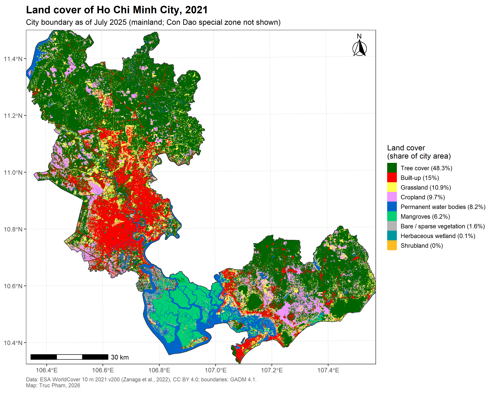

# Land cover of Ho Chi Minh City

Land cover map and area statistics for Ho Chi Minh City within its boundary from 1 July 2025,
based on ESA WorldCover 2021 at 10 m resolution.



## Study area

Since 1 July 2025, Ho Chi Minh City includes the former Ho Chi Minh City, Binh Duong and
Ba Ria - Vung Tau. The boundary is the union of these three provinces from GADM 4.1
(about 6,709 km²).

**Mainland only.** The Con Dao special zone (16 islands, about 76 km², ~230 km offshore)
is excluded. It covers about 1% of the city's area and is not included in the GADM boundaries.

## Results

| Land cover class | Area (km²) | Share of city |
| --- | ---: | ---: |
| Tree cover | 3,246 | 48.3% |
| Built-up | 1,005 | 15.0% |
| Grassland | 731 | 10.9% |
| Cropland | 654 | 9.7% |
| Permanent water bodies | 549 | 8.2% |
| Mangroves | 417 | 6.2% |
| Bare / sparse vegetation | 106 | 1.6% |
| Herbaceous wetland | 4 | 0.1% |
| Shrubland | 1 | < 0.1% |

- Built-up land (15%) is concentrated in the former Ho Chi Minh City core and extends north into Binh Duong.
- Mangroves (6%) are almost entirely in Can Gio, a UNESCO biosphere reserve.
- Tree cover (48%) likely includes rubber, cashew and fruit plantations, which WorldCover does
  not separate from natural forest.

Full table: [`outputs/hcmc_land_cover_by_class.csv`](outputs/hcmc_land_cover_by_class.csv)

## Method

| Step | Script | What it does |
| --- | --- | --- |
| 0 | `R/00_gee_export.js` | Exports ESA WorldCover 2021 (10 m, UTM zone 48N) for the study area from Google Earth Engine |
| 1 | `R/01_boundary.R` | Builds the 2025 city boundary from GADM provinces |
| 2 | `R/02_land_cover.R` | Clips land cover to the boundary and calculates the area of each class |
| 3 | `R/03_map.R` | Draws the map |

Areas are calculated from the full 10 m data (each pixel = 100 m²). The map is drawn at 50 m
(most common class in each 5 × 5 block) to keep the image size manageable.

## How to run

1. Run `R/00_gee_export.js` in the [Google Earth Engine Code Editor](https://code.earthengine.google.com)
   and save the exported GeoTIFF as `data/raw/hcmc_worldcover_2021.tif`.
2. In R (≥ 4.1), install the packages once:
```r
   install.packages(c("geodata", "sf", "stringi", "terra", "ggplot2", "ggspatial"))
```
3. Open `hcmc-land-cover.Rproj` and run the scripts in order: `01_boundary.R`, `02_land_cover.R`, `03_map.R`.

Raw data in `data/raw/` is not stored on GitHub because of file size; step 1 recreates it.

## Limitations

- WorldCover is a global product with known classification errors. Small or mixed features
  (narrow streets, small parks, aquaculture ponds) are less reliable than large uniform areas.
- Land cover is from 2021; the boundary is from 2025. The boundary change does not affect the land itself.
- GADM boundaries are simplified, so the area differs slightly from official figures.

## Data and licences

- Land cover: Zanaga, D., Van De Kerchove, R., Daems, D., et al. (2022). *ESA WorldCover 10 m 2021 v200*.
  [doi:10.5281/zenodo.7254221](https://doi.org/10.5281/zenodo.7254221). CC BY 4.0.
- Boundaries: [GADM 4.1](https://gadm.org), free for academic and non-commercial use.
- Code: [MIT](LICENSE).

## AI assistance

Code was developed step by step with help from Claude (Anthropic). I ran and checked every
step, verified the results against known geography and official area figures, and made all
methodological decisions.

## Author

**Truc Pham** · [truc-pham.github.io](https://truc-pham.github.io) · [ORCID 0009-0004-1892-492X](https://orcid.org/0009-0004-1892-492X)